# leetcode-problems

Solutions to the **39 LeetCode problems** of a 9-day interview study plan, written in **Java 25**,
documented with JavaDoc (Markdown doc comments) and covered by JUnit 5 tests.
Every problem lives in its own class, grouped by the technique of the day.

- [Quick start](#quick-start)
- [Project structure](#project-structure)
- [Java 25 features used](#java-25-features-used)
- [Engineering practices](#engineering-practices)
- [Study plan at a glance](#study-plan-at-a-glance)
- Write-ups: [Day 1](#day-1--arrays-1d-foundations--implementation-drills) ·
  [Day 2](#day-2--strings--string-manipulation) ·
  [Day 3](#day-3--two-pointers) ·
  [Day 4](#day-4--sliding-window) ·
  [Day 5](#day-5--matrix--multidimensional-arrays) ·
  [Day 6](#day-6--hashmaps--sets) ·
  [Day 7](#day-7--greedy-strategies) ·
  [Day 8](#day-8--divide--conquer--recursion) ·
  [Day 9](#day-9--full-codesignal-style-simulation)

---

## Quick start

**Requirements:** JDK 25 or newer and Maven 3.9 or newer (the build checks both with the
Maven Enforcer plugin and stops with a clear message if either is too old).

```bash
mvn verify                                    # compile + run every test
mvn test -Dtest=TrappingRainWaterTest         # run the tests of one problem
mvn package                                   # build target/leetcode-problems-1.0.0.jar
java -jar target/leetcode-problems-1.0.0.jar  # print the study plan
mvn javadoc:javadoc                           # HTML API docs, generated under target/
```

`java -jar` prints the catalogue of solutions:

```text
LeetCode Problems - 39 solutions in Java 25

DAY 1: ARRAYS (1D) FOUNDATIONS + IMPLEMENTATION DRILLS
  #88    Merge Sorted Array                                         Easy    MergeSortedArray
  #1480  Running Sum of 1d Array                                    Easy    RunningSumOf1dArray
  ...
By difficulty: {Easy=6, Hard=14, Medium=19}
```

Every public method has the **same name and signature as on LeetCode**, so a method body can be
pasted into the online judge's `class Solution` unchanged. Design problems keep LeetCode's class
names (`MedianFinder`, `MajorityChecker`).

---

## Project structure

```text
leetcode-problems
├── pom.xml
├── README.md
└── src
    ├── main/java/com/leetcodeproblems
    │   ├── LeetCodeProblemsApp.java     entry point: prints the study plan
    │   ├── ProblemCatalog.java          index of the 39 solutions, in plan order
    │   ├── catalog/                     @LeetCodeProblem, Difficulty, StudyDay, ProblemEntry
    │   ├── arrays/                      Day 1 — arrays (1D)
    │   ├── strings/                     Day 2 — strings
    │   ├── twopointers/                 Day 3 — two pointers
    │   ├── slidingwindow/               Day 4 — sliding window
    │   ├── matrix/                      Day 5 — matrices
    │   ├── hashing/                     Day 6 — hash maps and sets
    │   ├── greedy/                      Day 7 — greedy
    │   ├── divideandconquer/            Day 8 — divide and conquer + recursion
    │   └── simulation/
    │       ├── seta/                    Day 9 — simulation set A
    │       └── setb/                    Day 9 — simulation set B
    └── test/java/com/leetcodeproblems   same packages: one <Problem>Test class per problem
```

Why this layout:

- **Package by technique.** Each study day practises one technique, so each day is one package.
  Related solutions sit together, and the package name tells you which tool to reach for.
- **One class per problem**, named after the problem (`TrappingRainWater`, `SpiralMatrixIII`, …),
  each with a `package-info.java` describing the package.
- **Metadata next to the code.** Every solution carries a runtime annotation
  `@LeetCodeProblem(number, title, difficulty, day, pattern, slug)`. `ProblemCatalog` builds the
  study-plan index from those annotations, and `ProblemCatalogTest` checks that the plan is
  consistent (39 problems, unique numbers, every class in its day's package).
- **No dependency cycles.** The `catalog` package depends on nothing; solution packages depend
  only on `catalog`; only the root package knows about all solutions.
- **Tests mirror the main tree**, so each test sits in the same package as the class it tests.

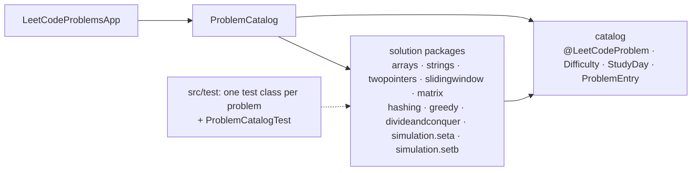

---

## Java 25 features used

The project compiles with `--release 25` and uses **no preview features**, so no
`--enable-preview` flag is needed.

| Feature | JEP | Final in | Where it is used |
|---|---|---|---|
| Markdown documentation comments (`///`) | 467 | Java 23 | Every class: JavaDoc written in Markdown (headings, lists, tables, code) |
| Instance `main` methods | 512 | Java 25 | `LeetCodeProblemsApp` declares `void main()` — no `static`, no `String[]` |
| `java.lang.IO` console helper | 512 | Java 25 | `LeetCodeProblemsApp` prints with `IO.println` |
| Module import declarations | 511 | Java 25 | `LeetCodeProblemsApp` uses `import module java.base;` |
| Flexible constructor bodies | 513 | Java 25 | `ProblemEntry(Class)` validates its argument *before* calling `this(...)` |
| Stream gatherers | 485 | Java 24 | `RunningSumOf1dArray#runningSumWithGatherer` uses `Gatherers.scan` |
| Unnamed variables `_` | 456 | Java 22 | `GroupAnagrams`: `computeIfAbsent(key, _ -> new ArrayList<>())` |
| Record patterns | 440 | Java 21 | `NumberOfIslands`, `NumberOfEnclaves`: `while (queue.poll() instanceof Cell(int row, int col))` |
| Sequenced collections | 431 | Java 21 | `ProblemCatalogTest`: `entries().getFirst()` / `getLast()` |
| `StringBuilder.repeat` | — | Java 21 | `TextJustification` pads lines with `line.repeat(' ', n)` |
| `HashSet.newHashSet(int)` | — | Java 19 | `LongestConsecutiveSequence` pre-sizes its set |
| Records | 395 | Java 16 | `ProblemEntry`, `MajorityChecker.Vote`, grid `Cell`s |
| Pattern matching for `instanceof` | 394 | Java 16 | `SubstringWithConcatenationOfAllWords`: `if (!(map.get(w) instanceof Integer allowed))` |
| Switch expressions | 361 | Java 14 | `SpiralMatrixIII.Heading#turnRight` |

---

## Engineering practices

- **Clear contracts.** Every public class and method has JavaDoc with the problem statement,
  the approach, the complexity, parameters and return values; `javadoc` runs with
  `-Xdoclint:all` without warnings.
- **No hidden side effects.** Inputs are only modified when LeetCode requires an in-place
  algorithm (Merge Sorted Array, Rotate Array, Move Zeroes, Rotate Image, Sudoku Solver…);
  everywhere else the methods work on copies, and the tests check that inputs are untouched.
- **Overflow awareness.** `long` sums in 4Sum and Two Sum II, `(low + high) >>> 1` midpoints,
  tests with `Integer.MIN_VALUE` / `Integer.MAX_VALUE`.
- **No recursion where depth is unbounded.** Grid searches use an explicit queue (tested on
  grids up to 500 × 500); recursion is used only where depth is logarithmic or tiny
  (merge sort, segment tree, trie search, Sudoku).
- **Tests at three levels** for each problem:
  1. LeetCode's own examples;
  2. hand-picked edge cases (empty input, single element, duplicates, extreme values);
  3. **randomised property tests with fixed seeds** that compare the solution with a slow but
     obviously correct brute force (all subsets, all partitions, all paths…). The seeds make
     every failure reproducible.
- **Reproducible build.** All plugin versions are pinned, the Enforcer plugin requires JDK 25 and
  Maven 3.9+, the compiler runs with `-Xlint:all`, and the JAR is executable.

---

## Study plan at a glance

| Day | # | Problem | Difficulty | Pattern | Class |
|---|---|---|---|---|---|
| 1 | 88 | [Merge Sorted Array](https://leetcode.com/problems/merge-sorted-array/) | Easy | Two pointers from the back | [`MergeSortedArray`](src/main/java/com/leetcodeproblems/arrays/MergeSortedArray.java) |
| 1 | 1480 | [Running Sum of 1d Array](https://leetcode.com/problems/running-sum-of-1d-array/) | Easy | Prefix sum | [`RunningSumOf1dArray`](src/main/java/com/leetcodeproblems/arrays/RunningSumOf1dArray.java) |
| 1 | 189 | [Rotate Array](https://leetcode.com/problems/rotate-array/) | Medium | In-place reversal | [`RotateArray`](src/main/java/com/leetcodeproblems/arrays/RotateArray.java) |
| 1 | 541 | [Reverse String II](https://leetcode.com/problems/reverse-string-ii/) | Easy | Two pointers, fixed stride | [`ReverseStringII`](src/main/java/com/leetcodeproblems/arrays/ReverseStringII.java) |
| 2 | 2911 | [Minimum Changes to Make K Semi-palindromes](https://leetcode.com/problems/minimum-changes-to-make-k-semi-palindromes/) | Hard | Partition DP + interval costs | [`MinimumChangesToMakeKSemiPalindromes`](src/main/java/com/leetcodeproblems/strings/MinimumChangesToMakeKSemiPalindromes.java) |
| 2 | 2514 | [Count Anagrams](https://leetcode.com/problems/count-anagrams/) | Hard | Multinomial coefficients, modular inverse | [`CountAnagrams`](src/main/java/com/leetcodeproblems/strings/CountAnagrams.java) |
| 2 | 3485 | [Longest Common Prefix of K Strings After Removal](https://leetcode.com/problems/longest-common-prefix-of-k-strings-after-removal/) | Hard | Sorting + window LCP + monotonic deque | [`LongestCommonPrefixOfKStringsAfterRemoval`](src/main/java/com/leetcodeproblems/strings/LongestCommonPrefixOfKStringsAfterRemoval.java) |
| 2 | 295 | [Find Median from Data Stream](https://leetcode.com/problems/find-median-from-data-stream/) | Hard | Two heaps | [`MedianFinder`](src/main/java/com/leetcodeproblems/strings/MedianFinder.java) |
| 3 | 167 | [Two Sum II - Input Array Is Sorted](https://leetcode.com/problems/two-sum-ii-input-array-is-sorted/) | Medium | Two pointers, opposite ends | [`TwoSumII`](src/main/java/com/leetcodeproblems/twopointers/TwoSumII.java) |
| 3 | 80 | [Remove Duplicates from Sorted Array II](https://leetcode.com/problems/remove-duplicates-from-sorted-array-ii/) | Medium | Read/write pointers | [`RemoveDuplicatesFromSortedArrayII`](src/main/java/com/leetcodeproblems/twopointers/RemoveDuplicatesFromSortedArrayII.java) |
| 3 | 283 | [Move Zeroes](https://leetcode.com/problems/move-zeroes/) | Easy | Read/write pointers | [`MoveZeroes`](src/main/java/com/leetcodeproblems/twopointers/MoveZeroes.java) |
| 3 | 42 | [Trapping Rain Water](https://leetcode.com/problems/trapping-rain-water/) | Hard | Two pointers + running maxima | [`TrappingRainWater`](src/main/java/com/leetcodeproblems/twopointers/TrappingRainWater.java) |
| 4 | 188 | [Best Time to Buy and Sell Stock IV](https://leetcode.com/problems/best-time-to-buy-and-sell-stock-iv/) | Hard | State-machine DP | [`BestTimeToBuyAndSellStockIV`](src/main/java/com/leetcodeproblems/slidingwindow/BestTimeToBuyAndSellStockIV.java) |
| 4 | 53 | [Maximum Subarray](https://leetcode.com/problems/maximum-subarray/) | Medium | Kadane (dynamic window) | [`MaximumSubarray`](src/main/java/com/leetcodeproblems/slidingwindow/MaximumSubarray.java) |
| 4 | 76 | [Minimum Window Substring](https://leetcode.com/problems/minimum-window-substring/) | Hard | Variable window + frequency table | [`MinimumWindowSubstring`](src/main/java/com/leetcodeproblems/slidingwindow/MinimumWindowSubstring.java) |
| 4 | 30 | [Substring with Concatenation of All Words](https://leetcode.com/problems/substring-with-concatenation-of-all-words/) | Hard | Word-sized windows + hash counts | [`SubstringWithConcatenationOfAllWords`](src/main/java/com/leetcodeproblems/slidingwindow/SubstringWithConcatenationOfAllWords.java) |
| 5 | 48 | [Rotate Image](https://leetcode.com/problems/rotate-image/) | Medium | Transpose + reverse rows | [`RotateImage`](src/main/java/com/leetcodeproblems/matrix/RotateImage.java) |
| 5 | 885 | [Spiral Matrix III](https://leetcode.com/problems/spiral-matrix-iii/) | Medium | Spiral simulation | [`SpiralMatrixIII`](src/main/java/com/leetcodeproblems/matrix/SpiralMatrixIII.java) |
| 5 | 1020 | [Number of Enclaves](https://leetcode.com/problems/number-of-enclaves/) | Medium | Multi-source BFS from the border | [`NumberOfEnclaves`](src/main/java/com/leetcodeproblems/matrix/NumberOfEnclaves.java) |
| 5 | 200 | [Number of Islands](https://leetcode.com/problems/number-of-islands/) | Medium | Connected components (BFS) | [`NumberOfIslands`](src/main/java/com/leetcodeproblems/matrix/NumberOfIslands.java) |
| 6 | 18 | [4Sum](https://leetcode.com/problems/4sum/) | Medium | Sorting + k-Sum to two pointers | [`FourSum`](src/main/java/com/leetcodeproblems/hashing/FourSum.java) |
| 6 | 49 | [Group Anagrams](https://leetcode.com/problems/group-anagrams/) | Medium | Hash map with canonical key | [`GroupAnagrams`](src/main/java/com/leetcodeproblems/hashing/GroupAnagrams.java) |
| 6 | 202 | [Happy Number](https://leetcode.com/problems/happy-number/) | Easy | Hash set / Floyd cycle detection | [`HappyNumber`](src/main/java/com/leetcodeproblems/hashing/HappyNumber.java) |
| 6 | 128 | [Longest Consecutive Sequence](https://leetcode.com/problems/longest-consecutive-sequence/) | Medium | Hash set + run starts | [`LongestConsecutiveSequence`](src/main/java/com/leetcodeproblems/hashing/LongestConsecutiveSequence.java) |
| 7 | 45 | [Jump Game II](https://leetcode.com/problems/jump-game-ii/) | Medium | Greedy range expansion (implicit BFS) | [`JumpGameII`](src/main/java/com/leetcodeproblems/greedy/JumpGameII.java) |
| 7 | 134 | [Gas Station](https://leetcode.com/problems/gas-station/) | Medium | Greedy reset on deficit | [`GasStation`](src/main/java/com/leetcodeproblems/greedy/GasStation.java) |
| 7 | 57 | [Insert Interval](https://leetcode.com/problems/insert-interval/) | Medium | Interval sweep | [`InsertInterval`](src/main/java/com/leetcodeproblems/greedy/InsertInterval.java) |
| 7 | 435 | [Non-overlapping Intervals](https://leetcode.com/problems/non-overlapping-intervals/) | Medium | Interval scheduling (earliest end) | [`NonOverlappingIntervals`](src/main/java/com/leetcodeproblems/greedy/NonOverlappingIntervals.java) |
| 8 | 704 | [Binary Search](https://leetcode.com/problems/binary-search/) | Easy | Binary search | [`BinarySearch`](src/main/java/com/leetcodeproblems/divideandconquer/BinarySearch.java) |
| 8 | 81 | [Search in Rotated Sorted Array II](https://leetcode.com/problems/search-in-rotated-sorted-array-ii/) | Medium | Modified binary search | [`SearchInRotatedSortedArrayII`](src/main/java/com/leetcodeproblems/divideandconquer/SearchInRotatedSortedArrayII.java) |
| 8 | 912 | [Sort an Array](https://leetcode.com/problems/sort-an-array/) | Medium | Merge sort | [`SortAnArray`](src/main/java/com/leetcodeproblems/divideandconquer/SortAnArray.java) |
| 8 | 1157 | [Online Majority Element In Subarray](https://leetcode.com/problems/online-majority-element-in-subarray/) | Hard | Segment tree + Boyer–Moore + binary search | [`MajorityChecker`](src/main/java/com/leetcodeproblems/divideandconquer/MajorityChecker.java) |
| 9A | 2472 | [Maximum Number of Non-overlapping Palindrome Substrings](https://leetcode.com/problems/maximum-number-of-non-overlapping-palindrome-substrings/) | Hard | Greedy interval scheduling | [`MaximumNumberOfNonOverlappingPalindromeSubstrings`](src/main/java/com/leetcodeproblems/simulation/seta/MaximumNumberOfNonOverlappingPalindromeSubstrings.java) |
| 9A | 238 | [Product of Array Except Self](https://leetcode.com/problems/product-of-array-except-self/) | Medium | Prefix × suffix products | [`ProductOfArrayExceptSelf`](src/main/java/com/leetcodeproblems/simulation/seta/ProductOfArrayExceptSelf.java) |
| 9A | 212 | [Word Search II](https://leetcode.com/problems/word-search-ii/) | Hard | Trie + backtracking | [`WordSearchII`](src/main/java/com/leetcodeproblems/simulation/seta/WordSearchII.java) |
| 9A | 68 | [Text Justification](https://leetcode.com/problems/text-justification/) | Hard | Greedy packing + simulation | [`TextJustification`](src/main/java/com/leetcodeproblems/simulation/seta/TextJustification.java) |
| 9B | 15 | [3Sum](https://leetcode.com/problems/3sum/) | Medium | Sorting + two pointers | [`ThreeSum`](src/main/java/com/leetcodeproblems/simulation/setb/ThreeSum.java) |
| 9B | 37 | [Sudoku Solver](https://leetcode.com/problems/sudoku-solver/) | Hard | Backtracking + bitmasks + MRV | [`SudokuSolver`](src/main/java/com/leetcodeproblems/simulation/setb/SudokuSolver.java) |
| 9B | 174 | [Dungeon Game](https://leetcode.com/problems/dungeon-game/) | Hard | Reverse grid DP | [`DungeonGame`](src/main/java/com/leetcodeproblems/simulation/setb/DungeonGame.java) |

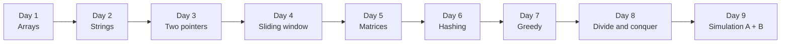

---

## Day 1 — Arrays (1D) Foundations + Implementation Drills

### 88. Merge Sorted Array

`Easy` · **Pattern:** two pointers, merging from the back ·
[Problem](https://leetcode.com/problems/merge-sorted-array/) ·
[Code](src/main/java/com/leetcodeproblems/arrays/MergeSortedArray.java)

**Problem.** `nums1` has room for `m + n` values: the first `m` are sorted and the last `n` are
empty slots. `nums2` holds `n` sorted values. Merge `nums2` into `nums1` in place so `nums1` is
sorted.

**Solution.** Merging from the front would overwrite values of `nums1` that have not been read
yet, but the **back** of `nums1` is free space. Keep three pointers: `i` on the last real value
of `nums1`, `j` on the last value of `nums2`, and `write` on the last slot. Copy the larger of
`nums1[i]` and `nums2[j]` into `nums1[write]`, then move that pointer and `write` left. When
`nums2` runs out, the rest of `nums1` is already in place.

**Complexity.** Time `O(m + n)` · Space `O(1)`.

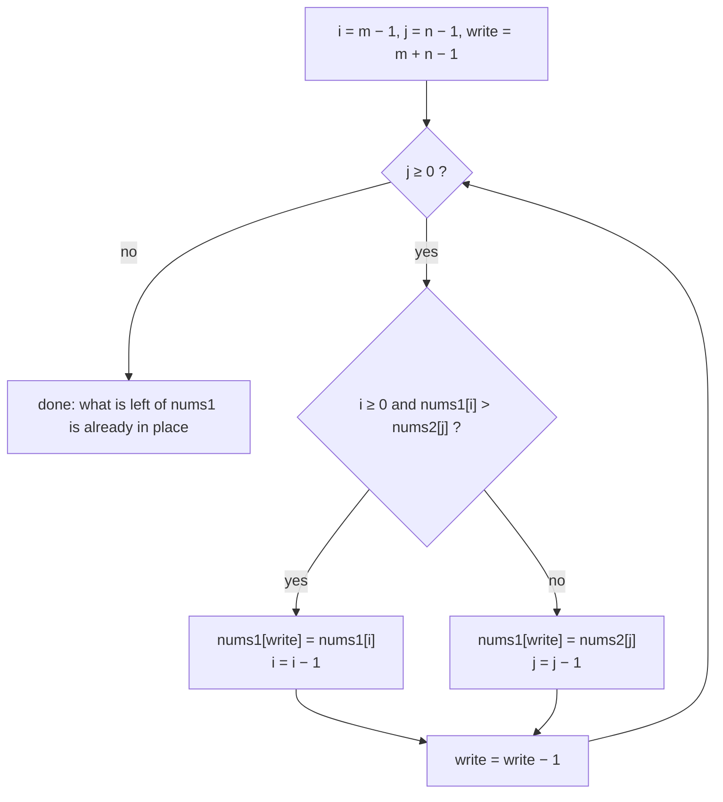

```text
nums1 = [1 2 3 _ _ _]  nums2 = [2 5 6]
  3 vs 6 → write 6     [1 2 3 _ _ 6]
  3 vs 5 → write 5     [1 2 3 _ 5 6]
  3 vs 2 → write 3     [1 2 3 3 5 6]
  2 vs 2 → write 2     [1 2 2 3 5 6]   nums2 exhausted → done
```

### 1480. Running Sum of 1d Array

`Easy` · **Pattern:** prefix sum ·
[Problem](https://leetcode.com/problems/running-sum-of-1d-array/) ·
[Code](src/main/java/com/leetcodeproblems/arrays/RunningSumOf1dArray.java)

**Problem.** Return an array where position `i` holds `nums[0] + … + nums[i]`.

**Solution.** Each running sum is the previous running sum plus the current value, so a single
accumulator is enough: add, store, move on. The class also contains a declarative version built
with a **stream gatherer**: `Gatherers.scan(() -> 0, Integer::sum)` emits every intermediate
result of the fold, which is exactly a prefix sum.

**Complexity.** Time `O(n)` · Space `O(1)` besides the output.

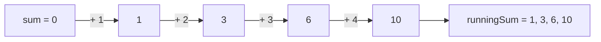

### 189. Rotate Array

`Medium` · **Pattern:** in-place reversal ·
[Problem](https://leetcode.com/problems/rotate-array/) ·
[Code](src/main/java/com/leetcodeproblems/arrays/RotateArray.java)

**Problem.** Rotate `nums` to the right by `k` steps, in place.

**Solution.** A right rotation moves the last `k` elements to the front and keeps the order
inside both blocks. Reversing the whole array puts the blocks in the right place but each block
backwards; reversing each block again fixes the order. Only `k mod n` steps matter, because
rotating by `n` changes nothing.

**Complexity.** Time `O(n)` · Space `O(1)`.

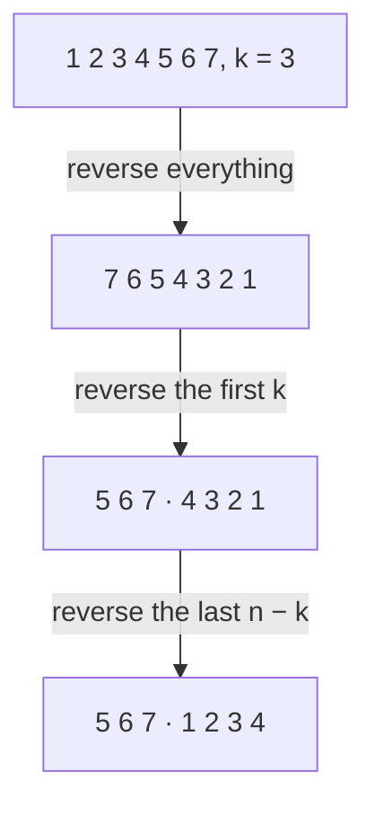

### 541. Reverse String II

`Easy` · **Pattern:** two pointers with a fixed stride ·
[Problem](https://leetcode.com/problems/reverse-string-ii/) ·
[Code](src/main/java/com/leetcodeproblems/arrays/ReverseStringII.java)

**Problem.** For every block of `2k` characters, reverse the first `k`. If fewer than `k`
characters remain, reverse all of them.

**Solution.** Walk the `char[]` with a stride of `2k`. In each block reverse the range
`[start, min(start + k, n) − 1]` with two pointers that swap and move towards each other; the
`min` handles the short last block without special cases.

**Complexity.** Time `O(n)` · Space `O(n)` for the `char[]` (strings are immutable).

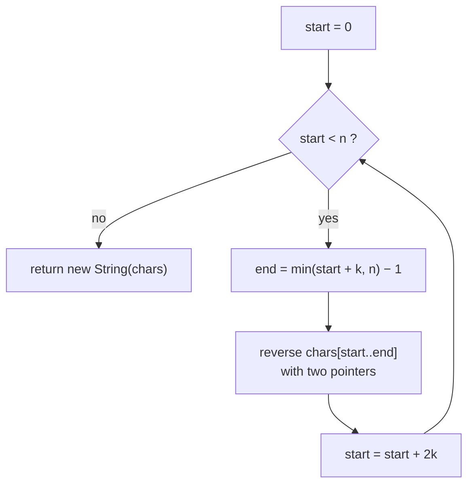

```text
s = "abcdefg", k = 2
blocks of 2k = 4:  [ab]cd  [ef]g
reverse first k:   ba cd   fe g     →  "bacdfeg"
```

---

## Day 2 — Strings + String Manipulation

### 2911. Minimum Changes to Make K Semi-palindromes

`Hard` · **Pattern:** partition DP over precomputed interval costs ·
[Problem](https://leetcode.com/problems/minimum-changes-to-make-k-semi-palindromes/) ·
[Code](src/main/java/com/leetcodeproblems/strings/MinimumChangesToMakeKSemiPalindromes.java)

**Problem.** A string of length `len` is a *semi-palindrome* if for some divisor `d` of `len`
with `1 ≤ d < len`, grouping the characters by `index mod d` gives groups that are all
palindromes. Split `s` into exactly `k` parts and return the minimum number of letter changes
that makes every part a semi-palindrome.

**Solution.**
1. **Cost of one part.** For every substring `s[i..j]` and every proper divisor `d` of its
   length, each group is fixed independently: compare the group's characters from both ends,
   every mismatch costs one change. `cost[i][j]` is the minimum over all `d`.
2. **Best split.** `dp[p][e]` is the minimum cost of splitting the prefix `s[0..e)` into `p`
   parts: `dp[p][e] = min over b of dp[p − 1][b] + cost[b][e − 1]`, with every part at least 2
   characters long (a single character cannot be a semi-palindrome). The answer is `dp[k][n]`.

**Complexity.** `n ≤ 200`: cost table `O(n² · Σ divisors · n)` in the worst case (a few
million steps), DP `O(k · n²)` · Space `O(n² + k · n)`.

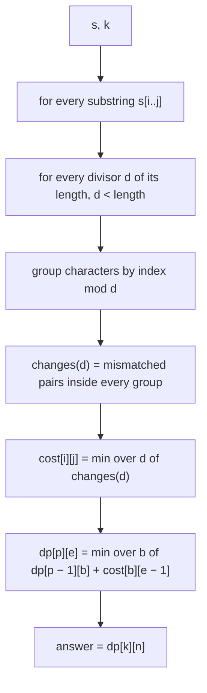

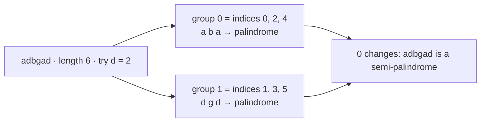

### 2514. Count Anagrams

`Hard` · **Pattern:** combinatorics (multinomial coefficients) with modular inverses ·
[Problem](https://leetcode.com/problems/count-anagrams/) ·
[Code](src/main/java/com/leetcodeproblems/strings/CountAnagrams.java)

**Problem.** `s` is a sentence of words. An anagram of `s` permutes the letters *inside* each
word but keeps the words in place. Count the distinct anagrams modulo `10^9 + 7`.

**Solution.** Words are independent, so the answer is the product of one count per word. A word
of length `L` whose letters occur `c₁, …, c₂₆` times has `L! / (c₁! · … · c₂₆!)` distinct
permutations (dividing removes the orderings of identical letters). Division modulo a prime `p`
is multiplication by the modular inverse, and by Fermat's little theorem
`x⁻¹ ≡ x^(p − 2) (mod p)`. We precompute `i!` and `(i!)⁻¹` for all `i ≤ |s|` (one fast
exponentiation plus the recurrence `((i − 1)!)⁻¹ = (i!)⁻¹ · i`).

**Complexity.** Time `O(n + 26 · words + log p)` · Space `O(n)`.

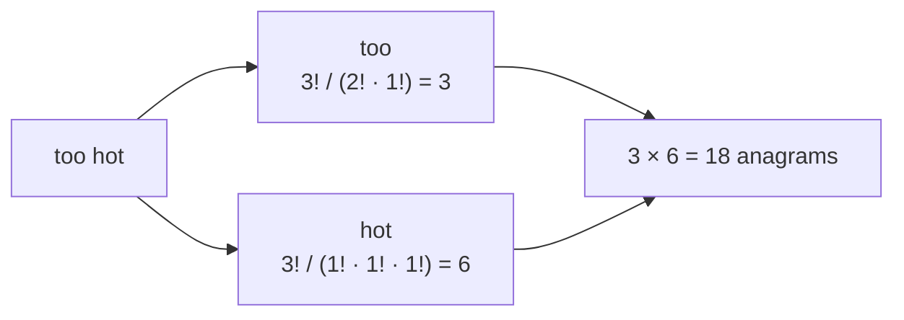

### 3485. Longest Common Prefix of K Strings After Removal

`Hard` · **Pattern:** sorting + window LCPs + prefix/suffix maxima + monotonic deque ·
[Problem](https://leetcode.com/problems/longest-common-prefix-of-k-strings-after-removal/) ·
[Code](src/main/java/com/leetcodeproblems/strings/LongestCommonPrefixOfKStringsAfterRemoval.java)

**Problem.** For every index `i`, remove `words[i]` and report the longest prefix shared by some
`k` of the remaining strings (`0` if fewer than `k` remain).

**Solution.**
- After sorting, strings with a common prefix are **contiguous**, so the best `k` strings are
  always `k` consecutive sorted strings, and the LCP of a sorted window is the LCP of its first
  and last strings. Compute `window[j] = lcp(sorted[j], sorted[j + k − 1])` for every window.
- Removing the string at sorted position `p` leaves:
  1. windows completely left of `p` → `prefixMax[p − k]`;
  2. windows completely right of `p` → `suffixMax[p + 1]`;
  3. windows that **jump over** `p`: old positions `j … j + k` without `p`. Their LCP is
     `widened[j] = lcp(sorted[j], sorted[j + k])`. The valid `j`s form a range that slides by one
     as `p` grows, so a **monotonic deque** gives its maximum in amortised `O(1)`.

**Complexity.** Time `O(n log n)` comparisons for sorting + `O(total length)` for all LCPs ·
Space `O(n)`.

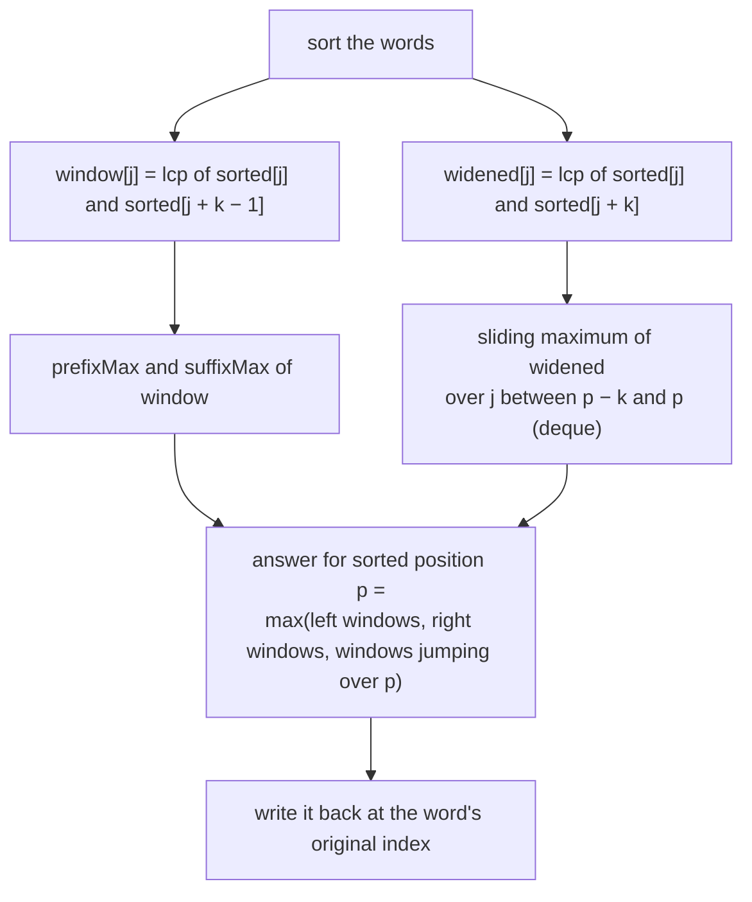

```text
words = [jump, run, run, jump, run], k = 2
sorted = jump  jump  run  run  run        window (k = 2) = 4 0 3 3
remove sorted[0] (jump) → best window on the right = 3 → answer[0] = 3
remove sorted[2] (run)  → window on the left = 4      → answer[1] = 4
result = [3, 4, 4, 3, 4]
```

### 295. Find Median from Data Stream

`Hard` · **Pattern:** two heaps ·
[Problem](https://leetcode.com/problems/find-median-from-data-stream/) ·
[Code](src/main/java/com/leetcodeproblems/strings/MedianFinder.java)

**Problem.** Design `MedianFinder` with `addNum(int)` and `findMedian()` that returns the median
of all numbers added so far.

**Solution.** Keep the smaller half in a **max-heap** (`lower`) and the larger half in a
**min-heap** (`upper`), with `lower` holding the same number of elements as `upper` or one more.
The median is then on top of the heaps. To insert: push into `lower`, move `lower`'s maximum to
`upper` (keeps every value of `lower` ≤ every value of `upper`), and if `upper` became bigger,
move its minimum back.

**Complexity.** `addNum` `O(log n)` · `findMedian` `O(1)` · Space `O(n)`.

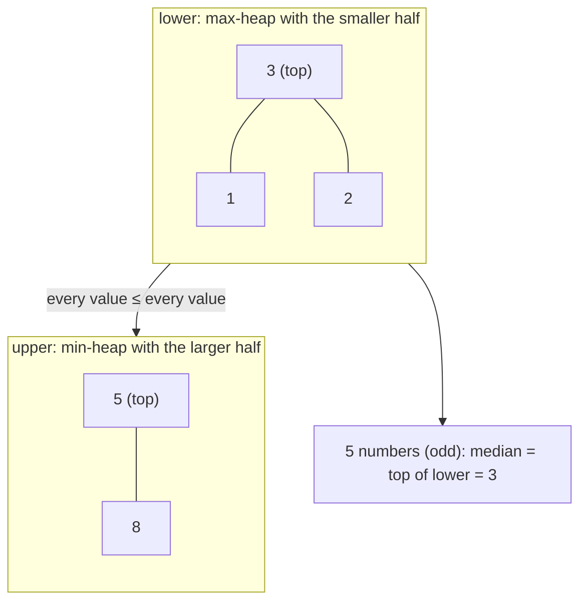

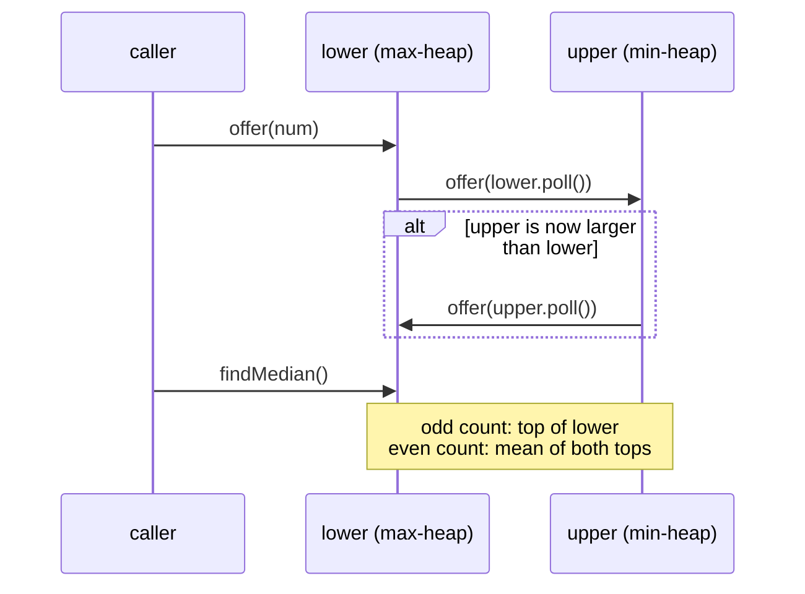

---

## Day 3 — Two Pointers

### 167. Two Sum II - Input Array Is Sorted

`Medium` · **Pattern:** two pointers from opposite ends ·
[Problem](https://leetcode.com/problems/two-sum-ii-input-array-is-sorted/) ·
[Code](src/main/java/com/leetcodeproblems/twopointers/TwoSumII.java)

**Problem.** In a sorted array find the two positions (1-indexed) whose values add up to
`target`, using constant extra space.

**Solution.** Start with the smallest (`left`) and the largest (`right`) value. If the sum is too
small, only moving `left` forwards can increase it; if it is too large, only moving `right`
backwards can decrease it. Every step safely discards one value, so the pair is found in one pass.

**Complexity.** Time `O(n)` · Space `O(1)`.

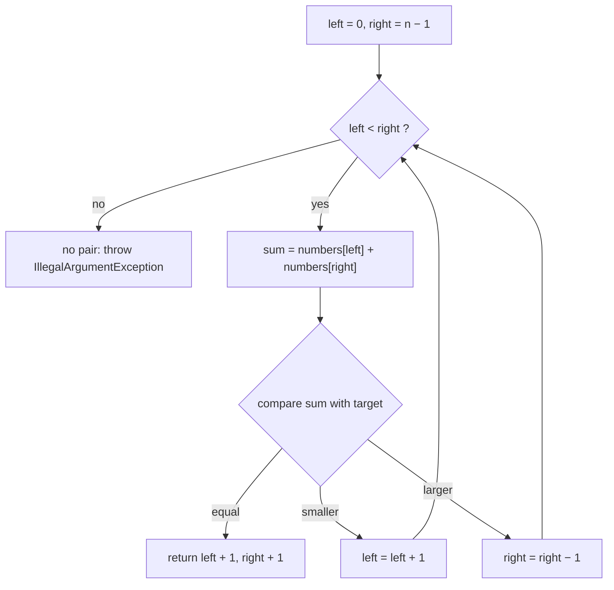

### 80. Remove Duplicates from Sorted Array II

`Medium` · **Pattern:** read/write (fast/slow) pointers ·
[Problem](https://leetcode.com/problems/remove-duplicates-from-sorted-array-ii/) ·
[Code](src/main/java/com/leetcodeproblems/twopointers/RemoveDuplicatesFromSortedArrayII.java)

**Problem.** In a sorted array keep at most two copies of each value, in place, and return the
new length.

**Solution.** `write` marks the end of the part we keep. Read every value; since the array is
sorted, a value may be kept iff it differs from `nums[write − 2]` — if they were equal, the kept
part would already end with two copies of it. Replacing `2` by `m` generalises the idea to "at
most `m` copies".

**Complexity.** Time `O(n)` · Space `O(1)`.

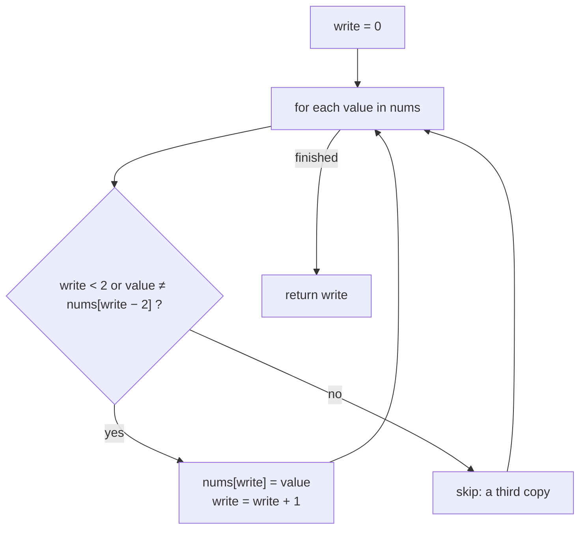

```text
nums = 1 1 1 2 2 3
read 1 → keep   [1]
read 1 → keep   [1 1]
read 1 → equals nums[write−2] = 1 → skip
read 2 → keep   [1 1 2]
read 2 → keep   [1 1 2 2]
read 3 → keep   [1 1 2 2 3]       length = 5
```

### 283. Move Zeroes

`Easy` · **Pattern:** read/write pointers (stable partition) ·
[Problem](https://leetcode.com/problems/move-zeroes/) ·
[Code](src/main/java/com/leetcodeproblems/twopointers/MoveZeroes.java)

**Problem.** Move all zeros to the end of the array, keeping the order of the other values,
in place.

**Solution.** `write` is where the next non-zero value belongs. Scan with `read`; whenever a
non-zero value appears at `read ≠ write`, move it to `write` and put a zero where it was
(everything between `write` and `read` is zero). Then advance `write`.

**Complexity.** Time `O(n)` · Space `O(1)`.

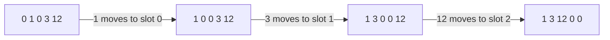

### 42. Trapping Rain Water

`Hard` · **Pattern:** two pointers with running maxima ·
[Problem](https://leetcode.com/problems/trapping-rain-water/) ·
[Code](src/main/java/com/leetcodeproblems/twopointers/TrappingRainWater.java)

**Problem.** Given bar heights, compute how much rain water is trapped between them.

**Solution.** Water above bar `i` is `min(highest bar to its left, highest bar to its right) −
height[i]`. Move two pointers inwards and always handle the **lower** side: if
`height[left] < height[right]`, there is a bar at least as tall on the right, so the water at
`left` depends only on `leftMax`. Add `leftMax − height[left]` and advance. The right side is
symmetric. No prefix/suffix arrays are needed.

**Complexity.** Time `O(n)` · Space `O(1)`.

```text
height = 0 1 0 2 1 0 1 3 2 1 2 1                   (## = bar, ~~ = water)

level 3 |                         ##
level 2 |             ## ~~ ~~ ~~ ## ## ~~ ##
level 1 |       ## ~~ ## ## ~~ ## ## ## ## ## ##
        +---------------------------------------
             0  1  0  2  1  0  1  3  2  1  2  1        trapped water = 6
```

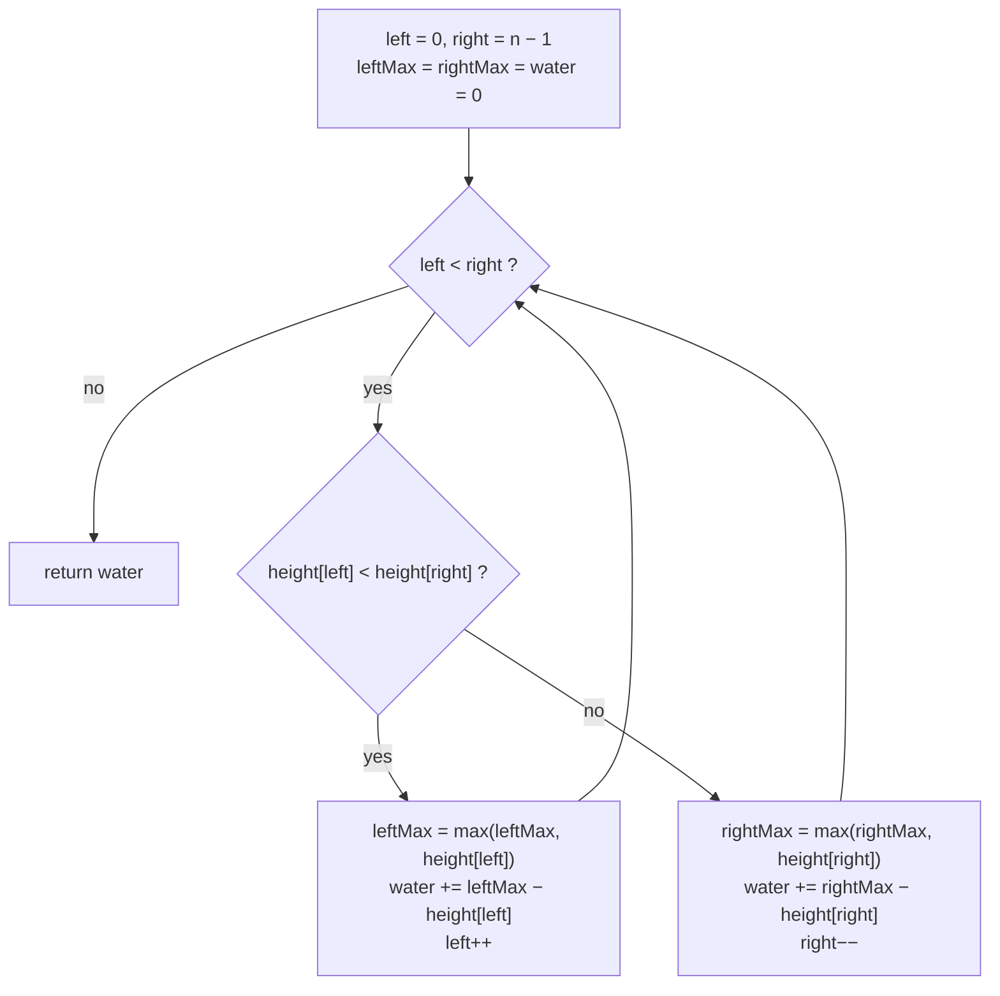

---

## Day 4 — Sliding Window

### 188. Best Time to Buy and Sell Stock IV

`Hard` · **Pattern:** state-machine dynamic programming ·
[Problem](https://leetcode.com/problems/best-time-to-buy-and-sell-stock-iv/) ·
[Code](src/main/java/com/leetcodeproblems/slidingwindow/BestTimeToBuyAndSellStockIV.java)

**Problem.** With daily `prices` and at most `k` buy/sell transactions (holding one share at a
time), return the maximum profit.

**Solution.** Sweep the days once, keeping for every transaction number `t` the best cash in two
states: `buy[t]` (holding after the `t`-th buy) and `sell[t]` (not holding after the `t`-th sell).
For price `p`:
`buy[t] = max(buy[t], sell[t − 1] − p)` and `sell[t] = max(sell[t], buy[t] + p)`.
Only the previous day's state is needed — a window of size one sliding over the timeline. If
`k ≥ n / 2`, the limit can never be reached, so we simply add every positive daily increase.

**Complexity.** Time `O(n · k)` (or `O(n)` when `k ≥ n / 2`) · Space `O(k)`.

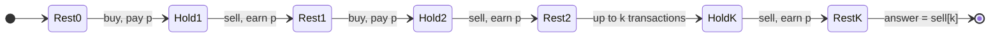

### 53. Maximum Subarray

`Medium` · **Pattern:** Kadane's algorithm (a window that always ends at the current index) ·
[Problem](https://leetcode.com/problems/maximum-subarray/) ·
[Code](src/main/java/com/leetcodeproblems/slidingwindow/MaximumSubarray.java)

**Problem.** Return the largest sum of a non-empty contiguous subarray.

**Solution.** The best window ending at `i` either extends the best window ending at `i − 1` or
starts fresh at `i`: `current = max(nums[i], current + nums[i])`. A negative running sum can
only hurt what follows, so the window's left edge jumps forward. The answer is the best
`current` seen.

**Complexity.** Time `O(n)` · Space `O(1)`.

| i | 0 | 1 | 2 | 3 | 4 | 5 | 6 | 7 | 8 |
|---|---|---|---|---|---|---|---|---|---|
| `nums[i]` | −2 | 1 | −3 | 4 | −1 | 2 | 1 | −5 | 4 |
| `current` | −2 | 1 | −2 | **4** | 3 | 5 | **6** | 1 | 5 |
| `best` | −2 | 1 | 1 | 4 | 4 | 5 | **6** | 6 | 6 |

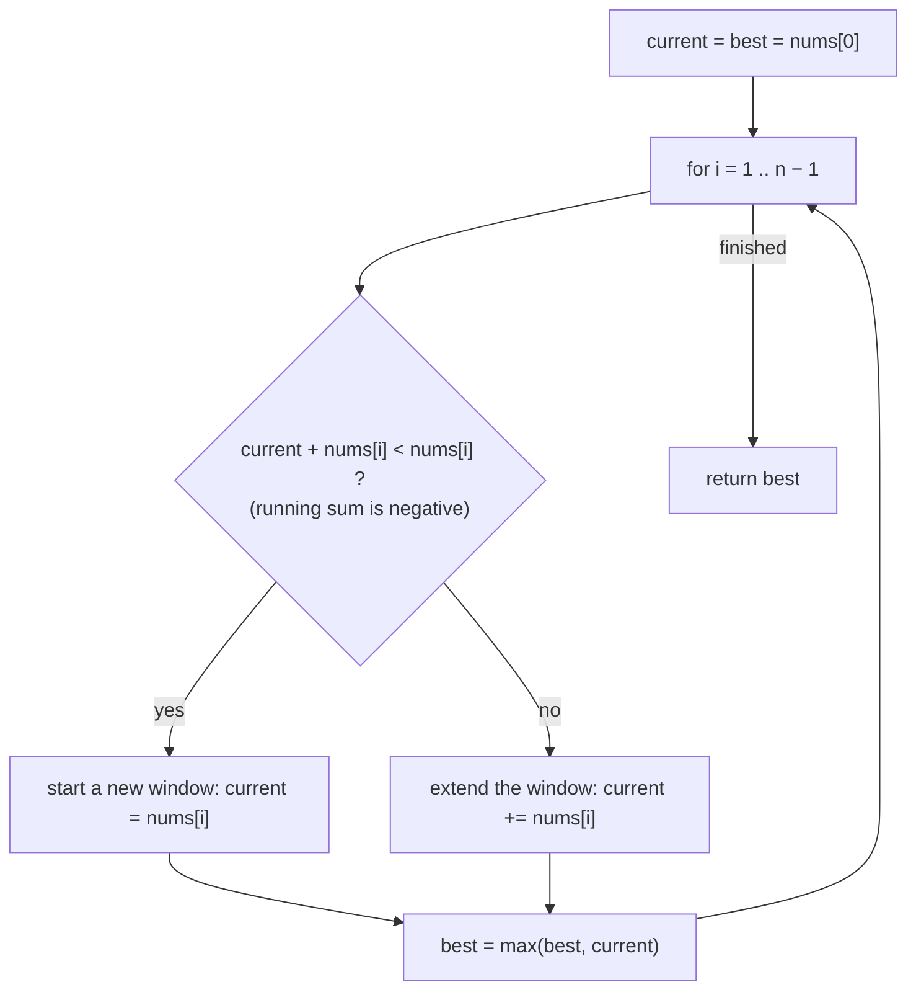

### 76. Minimum Window Substring

`Hard` · **Pattern:** variable-size sliding window + frequency table ·
[Problem](https://leetcode.com/problems/minimum-window-substring/) ·
[Code](src/main/java/com/leetcodeproblems/slidingwindow/MinimumWindowSubstring.java)

**Problem.** Return the shortest substring of `s` that contains every character of `t`
(with multiplicity), or `""`.

**Solution.** `need[c]` counts how many more `c`s the window needs and `missing` is the total
still needed. **Expand** by moving `right`: consuming a needed character decrements `missing`.
While `missing == 0` the window is valid: record it if it is the shortest, then **shrink** by
moving `left`; releasing a needed character makes the window invalid again. Each index enters
and leaves the window at most once.

**Complexity.** Time `O(|s| + |t|)` · Space `O(1)` (128 counters).

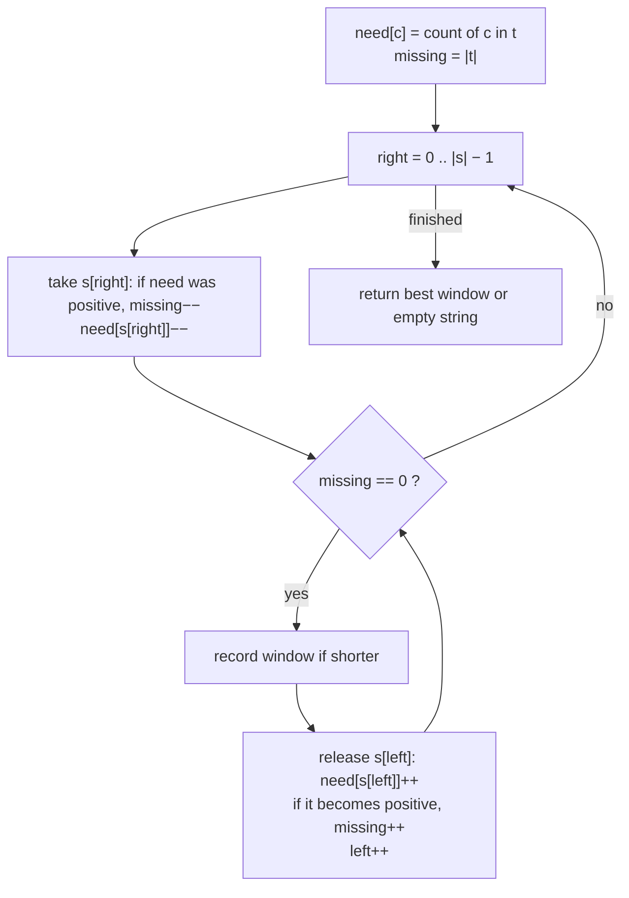

```text
s = ADOBECODEBANC, t = ABC
[ADOBEC]ODEBANC        first valid window (6)
 ADOBEC[ODEBA]NC       shrinking lost the A, expand to the next A
 ADOBECODE[BANC]       shrink as far as possible → "BANC" (4)
```

### 30. Substring with Concatenation of All Words

`Hard` · **Pattern:** sliding window over word-sized chunks + hash-map counts ·
[Problem](https://leetcode.com/problems/substring-with-concatenation-of-all-words/) ·
[Code](src/main/java/com/leetcodeproblems/slidingwindow/SubstringWithConcatenationOfAllWords.java)

**Problem.** All words have the same length `w`. Find every index of `s` where a concatenation
of *all* the words (each exactly once, any order) starts.

**Solution.** A match starts at some offset `0 ≤ offset < w` modulo `w`, so run `w` independent
passes; each pass reads `s` in chunks of `w` characters and slides a window of whole words:
- a chunk that is not a word clears the window;
- if a word is now over-represented, drop words from the left until its count is legal;
- when the window holds exactly `words.length` words, record its start and drop its first word.

**Complexity.** Time `O(|s| · w)` · Space `O(words · w)`.

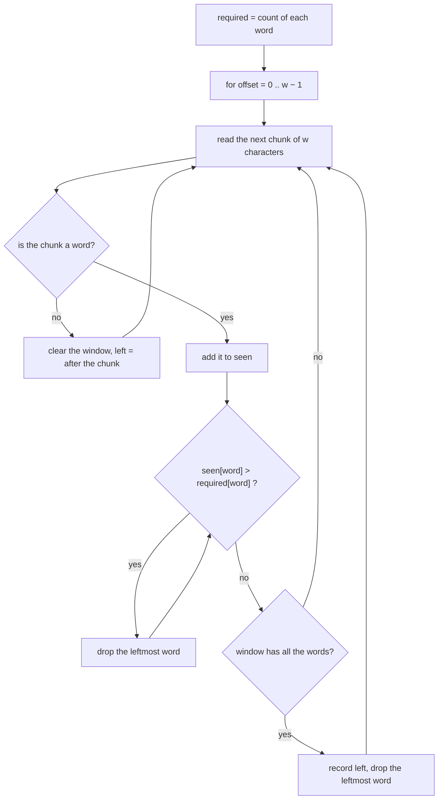

```text
s = barfoothefoobarman, words = [foo, bar]   (w = 3)
offset 0: |bar|foo|the|foo|bar|man|
           [bar foo] → 0      the clears      [foo bar] → 9      result = [0, 9]
```

---

## Day 5 — Matrix & Multidimensional Arrays

### 48. Rotate Image

`Medium` · **Pattern:** matrix transformation (transpose + reverse rows) ·
[Problem](https://leetcode.com/problems/rotate-image/) ·
[Code](src/main/java/com/leetcodeproblems/matrix/RotateImage.java)

**Problem.** Rotate an `n × n` matrix 90° clockwise in place.

**Solution.** Clockwise rotation sends `(r, c)` to `(c, n − 1 − r)`. That is a **transpose**
(`(r, c) → (c, r)`, swapping across the main diagonal) followed by a **horizontal mirror**
(`(r, c) → (r, n − 1 − c)`, reversing every row). Both are easy to do in place.

**Complexity.** Time `O(n²)` · Space `O(1)`.

```mermaid
flowchart LR
    A["1 2 3<br/>4 5 6<br/>7 8 9"] -- "transpose" --> B["1 4 7<br/>2 5 8<br/>3 6 9"]
    B -- "reverse each row" --> C["7 4 1<br/>8 5 2<br/>9 6 3"]
```

### 885. Spiral Matrix III

`Medium` · **Pattern:** simulation of a spiral walk ·
[Problem](https://leetcode.com/problems/spiral-matrix-iii/) ·
[Code](src/main/java/com/leetcodeproblems/matrix/SpiralMatrixIII.java)

**Problem.** Starting at `(rStart, cStart)` facing east, walk a clockwise spiral that may leave
the grid. Return the grid cells in the order they are visited.

**Solution.** A square spiral is made of straight legs of lengths `1, 1, 2, 2, 3, 3, …`, turning
right after each leg (east → south → west → north). Walk step by step and record a position only
when it is inside the grid; stop after `rows · cols` cells. The headings are an `enum` whose
`turnRight()` is a switch expression.

**Complexity.** Time `O(max(rows, cols)²)` · Space `O(rows · cols)` for the output.

```mermaid
flowchart LR
    E1["east 1"] --> S1["south 1"] --> W2["west 2"] --> N2["north 2"] --> E3["east 3"] --> S3["south 3"] --> W4["west 4"] --> N4["north 4"] --> More["…"]
```

```text
3 × 3 grid, start at the centre — visit order:
  7 8 9
  6 1 2
  5 4 3
```

### 1020. Number of Enclaves

`Medium` · **Pattern:** multi-source BFS flood fill from the border ·
[Problem](https://leetcode.com/problems/number-of-enclaves/) ·
[Code](src/main/java/com/leetcodeproblems/matrix/NumberOfEnclaves.java)

**Problem.** In a 0/1 grid, count the land cells from which you can never walk off the grid
(moving through adjacent land cells).

**Solution.** Think in reverse: start a BFS from **every land cell on the border** at once and mark
everything reachable — those cells can escape. Every land cell left unmarked is an enclave.
The BFS uses an explicit queue (no recursion) and a separate `reachable` matrix (the input is
not modified).

**Complexity.** Time `O(rows · cols)` · Space `O(rows · cols)`.

```mermaid
flowchart LR
    A["enqueue every land cell on the border"] --> B["BFS: mark land neighbours as reachable"]
    B --> C["count land cells that are not reachable"]
```

```text
0 0 0 0
1 0 1 0      the 1 at (1,0) is on the border → it can escape
0 1 1 0      (1,2), (2,1), (2,2) are surrounded by sea → 3 enclaves
0 0 0 0
```

### 200. Number of Islands

`Medium` · **Pattern:** connected components with BFS flood fill ·
[Problem](https://leetcode.com/problems/number-of-islands/) ·
[Code](src/main/java/com/leetcodeproblems/matrix/NumberOfIslands.java)

**Problem.** Count the groups of `'1'` cells connected horizontally or vertically.

**Solution.** Scan the grid; each unvisited land cell starts a new island: increment the counter
and flood-fill the whole island with a BFS so its cells are never counted again. The queue is
drained with a record pattern: `while (queue.poll() instanceof Cell(int row, int col))`.

**Complexity.** Time `O(rows · cols)` · Space `O(rows · cols)`.

```mermaid
flowchart TD
    A["for every cell"] --> B{"land and not visited?"}
    B -- "no" --> A
    B -- "yes" --> C["islands++"]
    C --> D["BFS from the cell: mark all connected land as visited"]
    D --> A
    A -- "finished" --> E["return islands"]
```

```text
1 1 0 0 0        A A . . .
1 1 0 0 0        A A . . .
0 0 1 0 0   →    . . B . .        3 islands
0 0 0 1 1        . . . C C
```

---

## Day 6 — HashMaps & Sets

### 18. 4Sum

`Medium` · **Pattern:** sorting + k-Sum reduction to two pointers ·
[Problem](https://leetcode.com/problems/4sum/) ·
[Code](src/main/java/com/leetcodeproblems/hashing/FourSum.java)

**Problem.** Return all unique quadruplets whose sum equals `target`.

**Solution.** With hashing, duplicates must be removed afterwards; **sorting** removes them for
free and allows two pointers. Fix the first value `i`, then the second `j`, skipping values
equal to the previous one at the same level. Find the last pair with two pointers moving
inwards, skipping duplicates after each hit. Prune when the smallest possible sum is already too
big (stop) or the largest possible sum is still too small (try the next value). Sums use `long`
because four values up to `10⁹` overflow `int`.

**Complexity.** Time `O(n³)` · Space `O(n)` for the sorted copy.

```mermaid
flowchart TD
    A["sort a copy of nums"] --> B["fix i (skip duplicate values)"]
    B --> C["fix j #gt; i (skip duplicate values)"]
    C --> D["low = j + 1, high = n − 1, need = target − a[i] − a[j]"]
    D --> E{"compare a[low] + a[high] with need"}
    E -- "equal" --> F["record quadruplet, skip duplicates, move both"]
    E -- "smaller" --> G["low++"]
    E -- "larger" --> H["high−−"]
    F --> E
    G --> E
    H --> E
```

### 49. Group Anagrams

`Medium` · **Pattern:** hash map with a canonical key ·
[Problem](https://leetcode.com/problems/group-anagrams/) ·
[Code](src/main/java/com/leetcodeproblems/hashing/GroupAnagrams.java)

**Problem.** Group the words that are anagrams of each other.

**Solution.** Two words are anagrams iff they have the same count of each letter. Turn the 26
counters into a 26-character string and use it as a hash-map key. This signature costs `O(L)`,
cheaper than sorting the letters (`O(L log L)`). A `LinkedHashMap` keeps groups in order of first
appearance, so the output is deterministic.

**Complexity.** Time `O(n · L)` · Space `O(n · L)`.

```mermaid
flowchart LR
    eat["eat"] --> K1["a1 e1 t1"]
    tea["tea"] --> K1
    ate["ate"] --> K1
    tan["tan"] --> K2["a1 n1 t1"]
    nat["nat"] --> K2
    bat["bat"] --> K3["a1 b1 t1"]
    K1 --> G1["eat, tea, ate"]
    K2 --> G2["tan, nat"]
    K3 --> G3["bat"]
```

### 202. Happy Number

`Easy` · **Pattern:** cycle detection — hash set, and Floyd's tortoise and hare ·
[Problem](https://leetcode.com/problems/happy-number/) ·
[Code](src/main/java/com/leetcodeproblems/hashing/HappyNumber.java)

**Problem.** Replace a number by the sum of the squares of its digits, repeatedly. It is *happy*
if this reaches 1.

**Solution.** The sequence stays bounded, so it always ends in a cycle; the number is happy iff
that cycle is `1 → 1`. `isHappy` remembers every value in a `HashSet` and stops at the first
repeat. `isHappyConstantSpace` uses **Floyd's algorithm**: a slow pointer moves one step and a
fast one two steps; they must meet inside the cycle, and the number is happy iff they meet at 1.

**Complexity.** Time `O(log n)` per step, few steps · Space `O(log n)` (set) or `O(1)` (Floyd).

```mermaid
flowchart LR
    subgraph Happy["19 is happy"]
        direction LR
        h19["19"] --> h82["82"] --> h68["68"] --> h100["100"] --> h1["1"]
        h1 --> h1
    end
    subgraph Unhappy["2 is not: it falls into the 4-cycle"]
        direction LR
        u2["2"] --> u4["4"] --> u16["16"] --> u37["37"] --> u58["58"] --> u89["89"] --> u145["145"] --> u42["42"] --> u20["20"] --> u4
    end
```

### 128. Longest Consecutive Sequence

`Medium` · **Pattern:** hash set, counting only from the start of each run ·
[Problem](https://leetcode.com/problems/longest-consecutive-sequence/) ·
[Code](src/main/java/com/leetcodeproblems/hashing/LongestConsecutiveSequence.java)

**Problem.** Return the length of the longest run of consecutive integers that can be formed
from the values of an unsorted array, in `O(n)`.

**Solution.** Put all values in a `HashSet`. A value `x` **starts** a run iff `x − 1` is not in
the set; only from such starts walk `x + 1, x + 2, …`. Every run is walked once, from its unique
start, so all the walks together cost `O(n)`. Bounds are checked so `Integer.MIN_VALUE` and
`Integer.MAX_VALUE` do not overflow.

**Complexity.** Time `O(n)` expected · Space `O(n)`.

```mermaid
flowchart LR
    S["set = 100, 4, 200, 1, 3, 2"] --> Q{"is x − 1 in the set?"}
    Q -- "yes: 2, 3, 4" --> Skip["not a run start: skip"]
    Q -- "no: 1, 100, 200" --> Walk["walk x + 1, x + 2, … while in the set"]
    Walk --> R1["1 → 2 → 3 → 4: length 4"]
    Walk --> R2["100: length 1"]
    Walk --> R3["200: length 1"]
    R1 --> A["answer = 4"]
    R2 --> A
    R3 --> A
```

---

## Day 7 — Greedy Strategies

### 45. Jump Game II

`Medium` · **Pattern:** greedy range expansion (BFS by levels without a queue) ·
[Problem](https://leetcode.com/problems/jump-game-ii/) ·
[Code](src/main/java/com/leetcodeproblems/greedy/JumpGameII.java)

**Problem.** From index `i` you can jump up to `nums[i]` steps forward. Return the minimum number
of jumps to reach the last index.

**Solution.** The indices reachable with `j` jumps form a contiguous range. While scanning the
current range, track `farthest`, the furthest index reachable with one more jump. When the scan
reaches the end of the range (`currentEnd`), a jump is unavoidable: count it and make
`farthest` the new range end. This is BFS on an implicit graph done in one pass.

**Complexity.** Time `O(n)` · Space `O(1)`.

```mermaid
flowchart LR
    subgraph L0["0 jumps"]
        i0["index 0 (2)"]
    end
    subgraph L1["1 jump"]
        i1["index 1 (3)"]
        i2["index 2 (1)"]
    end
    subgraph L2["2 jumps"]
        i3["index 3 (1)"]
        i4["index 4 = last"]
    end
    i0 --> i1
    i0 --> i2
    i1 --> i3
    i1 --> i4
```

### 134. Gas Station

`Medium` · **Pattern:** greedy — reset the start on a deficit ·
[Problem](https://leetcode.com/problems/gas-station/) ·
[Code](src/main/java/com/leetcodeproblems/greedy/GasStation.java)

**Problem.** On a circular route, station `i` gives `gas[i]` and reaching the next station costs
`cost[i]`. Return the station from which a full lap is possible, or `−1`.

**Solution.** If the total gas is less than the total cost, no start works. Otherwise, start at
0 and keep a running `tank`; if it becomes negative after station `i`, no station between the
current start and `i` can work either (each of them would reach `i` with even less fuel), so the
next candidate is `i + 1` with an empty tank. One pass decides everything.

**Complexity.** Time `O(n)` · Space `O(1)`.

```mermaid
flowchart TD
    A["total = tank = 0, start = 0"] --> B["for each station i"]
    B --> C["balance = gas[i] − cost[i]<br/>total += balance, tank += balance"]
    C --> D{"tank #lt; 0 ?"}
    D -- "yes" --> E["start = i + 1, tank = 0"]
    D -- "no" --> B
    E --> B
    B -- "finished" --> F{"total ≥ 0 ?"}
    F -- "yes" --> G["return start"]
    F -- "no" --> H["return −1"]
```

| station | 0 | 1 | 2 | 3 | 4 |
|---|---|---|---|---|---|
| gas − cost | −2 | −2 | −2 | +3 | +3 |
| tank (after reset) | reset | reset | reset | 3 | 6 |

`total = 0 ≥ 0`, so the answer is the last candidate: **station 3**.

### 57. Insert Interval

`Medium` · **Pattern:** interval sweep in three phases ·
[Problem](https://leetcode.com/problems/insert-interval/) ·
[Code](src/main/java/com/leetcodeproblems/greedy/InsertInterval.java)

**Problem.** Insert `newInterval` into a sorted list of disjoint intervals, merging overlaps.

**Solution.** Because the input is sorted and disjoint, intervals fall into three consecutive
groups: those ending **before** the new interval starts (copy), those **overlapping** it (absorb
by widening `start`/`end`), and those starting **after** it ends (copy).

**Complexity.** Time `O(n)` · Space `O(n)` for the output.

```mermaid
flowchart LR
    N["newInterval = [4,8]"] --> P1
    P1["phase 1: ends before 4<br/>[1,2] → copy"] --> P2["phase 2: overlaps [4,8]<br/>[3,5] [6,7] [8,10] → merge into [3,10]"]
    P2 --> P3["phase 3: starts after 10<br/>[12,16] → copy"]
    P3 --> R["result = [1,2] [3,10] [12,16]"]
```

### 435. Non-overlapping Intervals

`Medium` · **Pattern:** interval scheduling — keep the interval that ends first ·
[Problem](https://leetcode.com/problems/non-overlapping-intervals/) ·
[Code](src/main/java/com/leetcodeproblems/greedy/NonOverlappingIntervals.java)

**Problem.** Return the minimum number of intervals to remove so the rest do not overlap
(touching endpoints are fine).

**Solution.** Removing the fewest is keeping the most. Sort by **end** and greedily keep every
interval that starts at or after the end of the last kept one. Choosing the earliest end always
leaves the most room for the remaining intervals (an exchange argument proves it). Answer:
`n − kept`.

**Complexity.** Time `O(n log n)` · Space `O(n)`.

```mermaid
flowchart TD
    A["sort intervals by end"] --> B["lastEnd = −∞, kept = 0"]
    B --> C["next interval"]
    C --> D{"start ≥ lastEnd ?"}
    D -- "yes" --> E["keep it: kept++, lastEnd = end"]
    D -- "no" --> F["remove it"]
    E --> C
    F --> C
    C -- "finished" --> G["return n − kept"]
```

---

## Day 8 — Divide & Conquer + Recursion

### 704. Binary Search

`Easy` · **Pattern:** binary search ·
[Problem](https://leetcode.com/problems/binary-search/) ·
[Code](src/main/java/com/leetcodeproblems/divideandconquer/BinarySearch.java)

**Problem.** Find `target` in a sorted array in `O(log n)`, or return `−1`.

**Solution.** Keep the invariant "if the target exists, it is in `[low, high]`" and compare with
the middle element: found, or discard the half that cannot contain it. The midpoint
`(low + high) >>> 1` never overflows. The class offers the iterative version (no stack growth)
and a recursive one that mirrors the recurrence `T(n) = T(n / 2) + O(1)`.

**Complexity.** Time `O(log n)` · Space `O(1)` iterative, `O(log n)` recursive.

```mermaid
flowchart TD
    A["low = 0, high = n − 1"] --> B{"low ≤ high ?"}
    B -- "no" --> X["return −1"]
    B -- "yes" --> C["mid = (low + high) >>> 1"]
    C --> D{"compare nums[mid] with target"}
    D -- "equal" --> R["return mid"]
    D -- "smaller" --> L["low = mid + 1"] --> B
    D -- "larger" --> H["high = mid − 1"] --> B
```

### 81. Search in Rotated Sorted Array II

`Medium` · **Pattern:** modified binary search (find the sorted half) ·
[Problem](https://leetcode.com/problems/search-in-rotated-sorted-array-ii/) ·
[Code](src/main/java/com/leetcodeproblems/divideandconquer/SearchInRotatedSortedArrayII.java)

**Problem.** A sorted array **with duplicates** was rotated at an unknown pivot. Tell whether
`target` is in it.

**Solution.** For any `mid`, at least one half is sorted. If `nums[low] ≤ nums[mid]`, the left
half is sorted: continue there iff the target lies inside its range, otherwise go right.
Otherwise the right half is sorted and the same test applies to it. Duplicates add one blind
case — `nums[low] == nums[mid] == nums[high]` (e.g. `[1,0,1,1,1]`) — where we cannot tell which
half is sorted; since both ends equal `nums[mid]` (already checked), shrink both ends by one.

**Complexity.** Time `O(log n)` on average, `O(n)` worst case (many duplicates) · Space `O(1)`.

```mermaid
flowchart TD
    A["mid = (low + high) >>> 1"] --> B{"nums[mid] == target ?"}
    B -- "yes" --> T["return true"]
    B -- "no" --> C{"nums[low] == nums[mid] == nums[high] ?"}
    C -- "yes" --> D["low++, high−−"]
    C -- "no" --> E{"nums[low] ≤ nums[mid] ?"}
    E -- "yes: left half sorted" --> F{"target in [nums[low], nums[mid]) ?"}
    F -- "yes" --> G["high = mid − 1"]
    F -- "no" --> H["low = mid + 1"]
    E -- "no: right half sorted" --> I{"target in (nums[mid], nums[high]] ?"}
    I -- "yes" --> J["low = mid + 1"]
    I -- "no" --> K["high = mid − 1"]
```

### 912. Sort an Array

`Medium` · **Pattern:** merge sort (divide and conquer) ·
[Problem](https://leetcode.com/problems/sort-an-array/) ·
[Code](src/main/java/com/leetcodeproblems/divideandconquer/SortAnArray.java)

**Problem.** Sort an array in `O(n log n)` without built-in sort functions.

**Solution.** **Divide** the range in halves, **conquer** each half recursively and **combine** by
merging two sorted runs. Merge sort is `O(n log n)` in the worst case (quicksort can degrade on
adversarial inputs). Refinements: one auxiliary buffer is allocated once and reused; ranges
shorter than 16 elements use insertion sort; if the two halves are already in order
(`a[mid] ≤ a[mid + 1]`) the merge is skipped, so sorted input runs in linear time.

**Complexity.** Time `O(n log n)` · Space `O(n)` + `O(log n)` stack.

```mermaid
flowchart TD
    A["5 2 3 1"] --> B["5 2"]
    A --> C["3 1"]
    B --> D["5"]
    B --> E["2"]
    C --> F["3"]
    C --> G["1"]
    D --> H["2 5"]
    E --> H
    F --> I["1 3"]
    G --> I
    H --> J["1 2 3 5"]
    I --> J
```

### 1157. Online Majority Element In Subarray

`Hard` · **Pattern:** segment tree of Boyer–Moore votes + binary search on positions ·
[Problem](https://leetcode.com/problems/online-majority-element-in-subarray/) ·
[Code](src/main/java/com/leetcodeproblems/divideandconquer/MajorityChecker.java)

**Problem.** Build `MajorityChecker(arr)` and answer `query(left, right, threshold)`: the element
that occurs at least `threshold` times in `arr[left..right]`, or `−1`. It is guaranteed that
`2 · threshold > right − left + 1`, so the answer is always a strict majority.

**Solution.**
1. **Boyer–Moore votes can be merged.** Summarise a range as `(candidate, count)`. Two summaries
   combine like armies: equal candidates add up; different ones cancel and the larger survives
   with the difference. If a range has a strict majority, this merge always returns it.
2. Because the merge is associative, it fits a **segment tree**: build it bottom-up by divide
   and conquer, and answer a query by merging the `O(log n)` nodes that cover the range.
3. The candidate may still be short of `threshold`, so count its real occurrences with two
   binary searches in the sorted list of its positions.

**Complexity.** Build `O(n)` · Query `O(log n)` · Space `O(n)`.

```mermaid
flowchart TD
    R["[0,5] → (1, 2)"] --> A["[0,2] → (1, 1)"]
    R --> B["[3,5] → (1, 1)"]
    A --> A1["[0,1] → (1, 2)"]
    A --> A2["[2,2] → (2, 1)"]
    B --> B1["[3,4] → (2, 0)"]
    B --> B2["[5,5] → (1, 1)"]
    A1 --> A11["[0,0] → (1, 1)"]
    A1 --> A12["[1,1] → (1, 1)"]
    B1 --> B11["[3,3] → (2, 1)"]
    B1 --> B12["[4,4] → (1, 1)"]
```

```text
arr = [1, 1, 2, 2, 1, 1]               positions: 1 → [0, 1, 4, 5], 2 → [2, 3]
query(0, 5, 4): root vote = (1, 2) → candidate 1, occurs 4 times in [0,5]  → 1
query(0, 3, 3): [0,2] + [3,3] = (1,1) + (2,1) = (1, 0) → 1 occurs 2 times  → −1
query(2, 3, 2): [2,2] + [3,3] = (2, 2) → candidate 2, occurs 2 times       → 2
```

---

## Day 9 — Full CodeSignal-Style Simulation

### Set A

### 2472. Maximum Number of Non-overlapping Palindrome Substrings

`Hard` · **Pattern:** greedy interval scheduling over palindromes of length `k` and `k + 1` ·
[Problem](https://leetcode.com/problems/maximum-number-of-non-overlapping-palindrome-substrings/) ·
[Code](src/main/java/com/leetcodeproblems/simulation/seta/MaximumNumberOfNonOverlappingPalindromeSubstrings.java)

**Problem.** Select the maximum number of non-overlapping substrings that are palindromes of
length at least `k`.

**Solution.** Two observations:
1. Only lengths `k` and `k + 1` matter: a longer palindrome contains, around the same centre, a
   palindrome of length `k` or `k + 1` that ends earlier.
2. As in activity selection, taking the palindrome that **ends first** is always optimal.

Scan `start` left to right: take `s[start..start+k)` if it is a palindrome (earliest possible
end), else `s[start..start+k]` if that one is, else move `start` by one. After taking one,
continue right after it.

**Complexity.** Time `O(n · k)` · Space `O(1)`.

```mermaid
flowchart TD
    A["start = 0, count = 0"] --> B{"start + k ≤ n ?"}
    B -- "no" --> R["return count"]
    B -- "yes" --> C{"s[start .. start+k−1] palindrome ?"}
    C -- "yes" --> D["count++, start += k"] --> B
    C -- "no" --> E{"s[start .. start+k] palindrome ?"}
    E -- "yes" --> F["count++, start += k + 1"] --> B
    E -- "no" --> G["start++"] --> B
```

```text
s = abaccdbbd, k = 3
[aba]ccdbbd    "aba" is a palindrome of length k     → count 1, jump to index 3
aba ccd...     no palindrome of length 3 or 4 starts at c, c, d …
aba cc [dbbd]  "dbbd" has length k + 1               → count 2
```

### 238. Product of Array Except Self

`Medium` · **Pattern:** prefix and suffix products ·
[Problem](https://leetcode.com/problems/product-of-array-except-self/) ·
[Code](src/main/java/com/leetcodeproblems/simulation/seta/ProductOfArrayExceptSelf.java)

**Problem.** Return, for every index, the product of all the other elements, in `O(n)` and
without division.

**Solution.** `answer[i]` = (product of everything left of `i`) × (product of everything right of
`i`). A forward pass stores the left products in the output array; a backward pass multiplies in
a running right product. With no division, zeros need no special cases.

**Complexity.** Time `O(n)` · Space `O(1)` besides the output.

| i | 0 | 1 | 2 | 3 |
|---|---|---|---|---|
| `nums[i]` | 1 | 2 | 3 | 4 |
| product left of `i` | 1 | 1 | 2 | 6 |
| product right of `i` | 24 | 12 | 4 | 1 |
| **answer** | **24** | **12** | **8** | **6** |

```mermaid
flowchart LR
    A["pass 1, left → right<br/>answer[i] = prefix<br/>prefix *= nums[i]"] --> B["pass 2, right → left<br/>answer[i] *= suffix<br/>suffix *= nums[i]"]
```

### 212. Word Search II

`Hard` · **Pattern:** trie + backtracking DFS with pruning ·
[Problem](https://leetcode.com/problems/word-search-ii/) ·
[Code](src/main/java/com/leetcodeproblems/simulation/seta/WordSearchII.java)

**Problem.** Return every word of a list that can be traced on a letter board through adjacent
cells, using each cell at most once per word.

**Solution.** Put all words in a **trie** so words with a common prefix share a path. From each
cell, run a DFS that walks the board and the trie **together**: only step to a neighbour whose
letter is a child of the current trie node, so the search stops as soon as no word continues
with the current prefix. When a node marks the end of a word, record it and clear the mark (no
duplicates). While backtracking, **prune** trie nodes with no children and no word, so finished
branches are never explored again. A `visited` matrix keeps the input board unchanged.

**Complexity.** Time `O(cells · 3^L)` worst case (`L ≤ 10`), much less with pruning ·
Space `O(total letters)` for the trie.

```mermaid
flowchart TD
    root(("root")) --> o["o"] --> oa["a"] --> oat["t"] --> oath["h ★ oath"]
    root --> p["p"] --> pe["e"] --> pea["a ★ pea"]
    root --> e["e"] --> ea["a"] --> eat["t ★ eat"]
    root --> r["r"] --> ra["a"] --> rai["i"] --> rain["n ★ rain"]
```

```mermaid
flowchart TD
    A["DFS(cell, trie node)"] --> B{"letter is a child of the node?"}
    B -- "no" --> X["return: no word has this prefix"]
    B -- "yes" --> C{"child ends a word?"}
    C -- "yes" --> D["record word, clear the mark"]
    C -- "no" --> E["mark cell visited"]
    D --> E
    E --> F["DFS on the 4 unvisited neighbours"]
    F --> G["unmark cell"]
    G --> H{"child has no children and no word?"}
    H -- "yes" --> I["prune child from the trie"]
    H -- "no" --> J["return"]
```

### 68. Text Justification

`Hard` · **Pattern:** greedy line packing + string simulation ·
[Problem](https://leetcode.com/problems/text-justification/) ·
[Code](src/main/java/com/leetcodeproblems/simulation/seta/TextJustification.java)

**Problem.** Format words into lines of exactly `maxWidth` characters: as many words per line as
fit, extra spaces spread as evenly as possible with the **left** gaps getting more, and the last
line (and single-word lines) left-justified.

**Solution.**
1. **Pack:** add words while `letters + nextWord + gaps ≤ maxWidth` (one mandatory space per gap).
2. **Distribute:** `spaces = maxWidth − letters` over `gaps = words − 1`: every gap gets
   `spaces / gaps`, and the first `spaces % gaps` gaps get one more.
3. **Special lines:** the last line and single-word lines are joined with single spaces and
   padded on the right with `StringBuilder.repeat`.

**Complexity.** Time `O(total output length)` · Space `O(maxWidth)` per line.

```mermaid
flowchart TD
    A["from = first word of the line"] --> B["add words while letters + gaps ≤ maxWidth"]
    B --> C{"last line or a single word?"}
    C -- "yes" --> D["join with one space, pad right"]
    C -- "no" --> E["spaces = maxWidth − letters<br/>each gap: spaces / gaps<br/>first spaces % gaps gaps: one more"]
    D --> F["next line"]
    E --> F
    F --> A
```

```text
maxWidth = 16
"This    is    an"     3 words, 8 letters → 8 spaces over 2 gaps = 4 + 4
"example  of text"     3 words, 13 letters → 3 spaces over 2 gaps = 2 + 1
"justification.  "     last line → left-justified and padded
```

### Set B

### 15. 3Sum

`Medium` · **Pattern:** sorting + two pointers ·
[Problem](https://leetcode.com/problems/3sum/) ·
[Code](src/main/java/com/leetcodeproblems/simulation/setb/ThreeSum.java)

**Problem.** Return all unique triplets that sum to zero.

**Solution.** Sort a copy. Fix the smallest element `sorted[i]` (skip it if equal to the previous
one; stop once it is positive, since three positives cannot sum to zero) and look for a pair
summing to `−sorted[i]` with two pointers in the rest of the array, skipping duplicates after
each hit.

**Complexity.** Time `O(n²)` · Space `O(n)` for the sorted copy.

```mermaid
flowchart TD
    A["sort a copy"] --> B["fix i while sorted[i] ≤ 0, skip duplicate values"]
    B --> C["low = i + 1, high = n − 1"]
    C --> D{"sum = sorted[i] + sorted[low] + sorted[high]"}
    D -- "= 0" --> E["record triplet, skip duplicates, low++, high−−"]
    D -- "#lt; 0" --> F["low++"]
    D -- "#gt; 0" --> G["high−−"]
    E --> D
    F --> D
    G --> D
```

```text
nums = [-1, 0, 1, 2, -1, -4]  →  sorted = [-4, -1, -1, 0, 1, 2]
i = -4 : no pair sums to 4
i = -1 : (-1, 2) → [-1, -1, 2]   (0, 1) → [-1, 0, 1]
i = -1 : skipped (duplicate)
result = [[-1, -1, 2], [-1, 0, 1]]
```

### 37. Sudoku Solver

`Hard` · **Pattern:** backtracking with bitmasks and the "most constrained cell" (MRV) heuristic ·
[Problem](https://leetcode.com/problems/sudoku-solver/) ·
[Code](src/main/java/com/leetcodeproblems/simulation/setb/SudokuSolver.java)

**Problem.** Fill the empty cells of a 9 × 9 Sudoku in place; the puzzle has exactly one solution.

**Solution.**
- **Bitmasks.** `rows[r]`, `cols[c]` and `boxes[b]` are 9-bit sets of digits already used. The
  candidates of a cell are `~(rows[r] | cols[c] | boxes[b]) & 0x1FF` — one expression — and
  `Integer.bitCount` counts them.
- **MRV.** Always branch on the empty cell with the **fewest** candidates. Single-candidate cells
  are filled without real branching and a cell with no candidates triggers an immediate
  backtrack, which shrinks the search tree enormously.
- **Backtracking.** Try each candidate digit, recurse, and undo the move on failure.

**Complexity.** Exponential in the worst case, but typical puzzles — including a famous "hardest"
puzzle in the tests — are solved in milliseconds · Space `O(81)` recursion depth.

```mermaid
flowchart TD
    A["solve()"] --> B["find the empty cell with the fewest candidates"]
    B --> C{"no empty cell?"}
    C -- "yes" --> OK["solved: return true"]
    C -- "no" --> D["for each candidate digit (bit of the mask)"]
    D --> E["place digit, update row/col/box masks"]
    E --> F{"solve() succeeds?"}
    F -- "yes" --> OK
    F -- "no" --> G["undo: clear digit, update masks"]
    G --> D
    D -- "no candidates left" --> FAIL["return false (backtrack)"]
```

### 174. Dungeon Game

`Hard` · **Pattern:** dynamic programming in reverse (bottom-up grid DP) ·
[Problem](https://leetcode.com/problems/dungeon-game/) ·
[Code](src/main/java/com/leetcodeproblems/simulation/setb/DungeonGame.java)

**Problem.** A knight walks from the top-left to the bottom-right room moving only right or
down; each room adds or removes health and he dies at 0. Return the minimum initial health that
guarantees he survives.

**Solution.** Forward DP fails because the best path depends on both the lowest health along the
way and the final health. Backwards it is simple: `need[r][c]` is the health needed when
**entering** room `(r, c)`:
`need[r][c] = max(1, min(need[r + 1][c], need[r][c + 1]) − dungeon[r][c])`.
Only the row below is needed, so one array of `cols + 1` cells suffices, seeded with a virtual
`1` below the princess.

**Complexity.** Time `O(rows · cols)` · Space `O(cols)`.

```text
dungeon                need (filled from bottom-right to top-left)
 -2   -3    3           7    5    2
 -5  -10    1           6   11    5
 10   30   -5           1    1    6        answer = need[0][0] = 7
```

```mermaid
flowchart LR
    Down["need below"] --> Min["cheapest = min(below, right)"]
    Right["need to the right"] --> Min
    Min --> Cell["need here = max(1, cheapest − dungeon[r][c])"]
```
